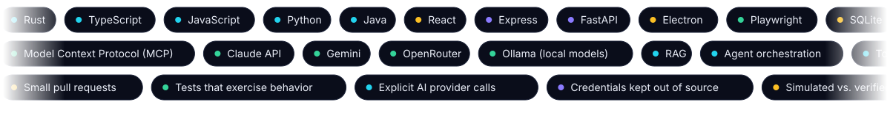

<!-- Written by Kone Tshivhinda & Claude -->
<!-- Visuals in /assets are self-hosted animated SVGs: no third-party image services to rate-limit or go down. -->

 

<a href="#about">About</a> &nbsp;·&nbsp; <a href="#selected-projects">Projects</a> &nbsp;·&nbsp; <a href="#how-my-agents-are-built">Agents</a> &nbsp;·&nbsp; <a href="#how-i-work">How I work</a> &nbsp;·&nbsp; <a href="#earlier-work-and-learning">Earlier work</a> &nbsp;·&nbsp; <a href="#activity">Activity</a> &nbsp;·&nbsp; <a href="#connect">Connect</a>

## About

**Software engineer building AI agents, practical automation, and civic tech
in South Africa. Founder of K-ONE IT SOLUTIONS.**

I build applications that connect a useful workflow with clear access controls,
reliable setup, and tests. My work spans agent-native services with MCP servers,
desktop and private AI assistants, civic reporting, and operational tools.

I am interested in engineering opportunities, collaborators, and people who want
to try these projects. Start with the repositories below; each one documents
its current scope and setup.

## Selected projects

<table>
<tr>
<td width="50%"></td>
<td width="50%"></td>
</tr>
<tr>
<td width="50%"></td>
<td width="50%"></td>
</tr>
<tr>
<td width="50%"></td>
<td width="50%"></td>
</tr>
</table>

<b>What's inside each project</b>

 

**[ClearCut](https://github.com/konethegreat/clearcut)** · Rust, Apache-2.0, alpha
- One Rust core exposed as a REST API (axum), a stdio MCP server (rmcp) and a Claude plugin, with a typed TypeScript client.
- Today: invoice calculation with integer-cent money, lifecycle rules and South African VAT thresholds, covered by 20 tests. MCP tools: `calculate_invoice`, `za_required_tax_invoice`, `check_status_transition`.
- Designed but not built yet: document ingestion, narration and export, persistence, e-invoicing and payments. The roadmap says so up front.

**[SA Job Agent Suite](https://github.com/konethegreat/scratch)** · Electron, React, Express, MIT
- Three agents: a Job Hunter (Claude grounded web search, with job-board scrapers as a fallback), a Document Tailor (CVs and cover letters via Gemini, Claude or OpenRouter, rendered to PDF) and an Apply Copilot (a persistent browser assistant that fills forms).
- Safety by design: it never auto-submits, never solves CAPTCHAs, and scans pages for prompt injection. API keys stay in a separate store and are never sent to the client.
- Verified with 65 server tests and a repeatable synthetic walkthrough (`npm run demo`) that needs no live job sites or paid AI calls. The public repo is a clean source snapshot.

**[Diary](https://github.com/konethegreat/Diary)** · FastAPI, SQLite, PolyForm Noncommercial
- A single-user diary where AI polishes notes and scores mood, writes a morning brief, a weekly review and a monthly coach that remembers context, and answers questions over your entries with RAG.
- Switch between the Claude API and local Ollama with one click. Entries stay in a local SQLite database, and only your own email can sign in.

**[Vigil](https://github.com/konethegreat/Vigil)** · Java, Python, TypeScript, PostgreSQL, in development
- "Sovereign operational intelligence for Africa": an ontology of real assets, people, places and events that operators, analysts and AI agents act on through governed, audited actions.
- The current local build connects a Java/PostgreSQL core, a Python intelligence service and a TypeScript cockpit. Analysts review quoted proposals from optional local models before anything is published, and the demonstrations use synthetic data.

**[MuniSolve ZA](https://github.com/konethegreat/munisolve-za)** · React, Express · [live app](https://munisolve-za.vercel.app/)
- Citizen and admin workflows for municipal fault reporting, with authorization tests and GitHub Actions checks.

**[Server Health Monitor](https://github.com/konethegreat/server-health-monitor)** · Python
- Configurable CPU, memory and disk checks with Slack and SMTP alerts, tests on Windows and Linux, and Docker support.

## How my agents are built

Agent projects fail in predictable ways: tools that do too much, no one accountable for the final action, and claims that outrun the code. These are the habits I build around, and where each one shows up.

| Principle | What it looks like in practice | Where |
| --- | --- | --- |
| **Humans keep the final say** | The apply copilot fills the form and stops before Submit. ClearCut's design has agents draft while policy and people approve. | [SA-JAS](https://github.com/konethegreat/scratch), [ClearCut](https://github.com/konethegreat/clearcut) |
| **Narrow, tested tools** | MCP tools expose single rules, such as VAT checks and status transitions, backed by a deterministic Rust core with integer-cent money. | [ClearCut](https://github.com/konethegreat/clearcut) |
| **Private by default, provider by choice** | Claude, Gemini, OpenRouter or local Ollama are explicit choices, keys live outside the client, and personal data stays on your machine. | [Diary](https://github.com/konethegreat/Diary), [SA-JAS](https://github.com/konethegreat/scratch) |
| **Untrusted input stays untrusted** | Pages are scanned for prompt injection, CAPTCHAs are handed off to a person, and model proposals are quoted and reviewed before they are used. | [SA-JAS](https://github.com/konethegreat/scratch), [Vigil](https://github.com/konethegreat/Vigil) |
| **Honest about status** | Alpha means alpha. Simulated and verified behavior are documented separately, and unbuilt phases are listed as unbuilt. | [ClearCut](https://github.com/konethegreat/clearcut) |

## How I work

- Use small pull requests with checks that exercise meaningful behavior.
- Keep AI provider calls explicit and protect local data and credentials.
- Document which integrations are simulated and which have been verified live.
- Improve setup guides and examples so another person can reproduce the work.

My current tools include Rust, TypeScript/JavaScript, Python, React, Express,
FastAPI, Electron, SQL, Docker, and GitHub Actions. I use AI coding tools as part
of the development process and review the resulting behavior and changes.

## Earlier work and learning

My IBM coursework and earlier experiments remain available with their upstream
attribution. Examples include the [plant-shop frontend](https://github.com/konethegreat/e-plantShopping),
[book-review API](https://github.com/konethegreat/expressBookReviews), and
[full-stack capstone](https://github.com/konethegreat/xrwvm-fullstack_developer_capstone).

Also public: the [K-ONE IT SOLUTIONS website source](https://github.com/konethegreat/k-one-it-solutions-website)
(static HTML, CSS and JavaScript; live at [k-oneitsolutions.live](https://k-oneitsolutions.live/)),
and a historical [React/Express/MongoDB social-media prototype](https://github.com/konethegreat/k-one-solutions-media)
that needs further maintenance.

## Activity

<!-- Contribution snake: regenerated daily by .github/workflows/snake.yml (published to the `output` branch) -->
<picture>
  <source media="(prefers-color-scheme: dark)" srcset="https://raw.githubusercontent.com/konethegreat/konethegreat/output/github-contribution-grid-snake-dark.svg" />
  <source media="(prefers-color-scheme: light)" srcset="https://raw.githubusercontent.com/konethegreat/konethegreat/output/github-contribution-grid-snake.svg" />
  
</picture>

## Connect

- [LinkedIn](https://www.linkedin.com/in/kone-tshivhinda-32a760233)
- [Email](mailto:erictshivhinda@gmail.com)
- [Credly profile](https://www.credly.com/users/kone-tshivhinda)
- [Portfolio](https://konethegreat.github.io/)
- [K-ONE IT SOLUTIONS](https://k-oneitsolutions.live/)

For bugs and contribution ideas, use the issue tracker on the relevant repository
and include reproduction steps without private data or credentials.

