<!-- Written by Kone Tshivhinda & Claude -->
<!-- Visuals in /assets are self-hosted animated SVGs: no third-party image services to rate-limit or go down. -->

 

<a href="#about">About</a> &nbsp;·&nbsp; <a href="#selected-projects">Projects</a> &nbsp;·&nbsp; <a href="#how-i-work">How I work</a> &nbsp;·&nbsp; <a href="#learning-projects">Learning</a> &nbsp;·&nbsp; <a href="#activity">Activity</a> &nbsp;·&nbsp; <a href="#connect">Connect</a>

## About

**Software engineer building civic tech, legal tech, and practical AI automation
in South Africa. Founder of K-ONE IT SOLUTIONS.**

I build applications that connect a useful workflow with clear access controls,
reliable setup, and tests. My work spans municipal reporting, legal time capture,
desktop AI assistants, and operational tools.

I am interested in engineering opportunities, collaborators, and people who want
to try these projects. Start with the repositories below; each one documents
its current scope and setup.

## Selected projects

<table>
<tr>
<td width="50%"></td>
<td width="50%"></td>
</tr>
<tr>
<td width="50%"></td>
<td width="50%"></td>
</tr>
<tr>
<td width="50%"></td>
<td width="50%"></td>
</tr>
</table>

The original [TimeLex prototype](https://github.com/konethegreat/timelex-automated-time-tracking)
shows an earlier iteration. New work focuses on v2.

You can also explore [MB IQ](https://github.com/konethegreat/MB-IQ), an engineering
workspace demo, and the [legal performance-management demo](https://github.com/konethegreat/mostoeneng-pms).
Both public snapshots use demo data and document their setup and verification
limits. My [company website source](https://github.com/konethegreat/k-one-it-solutions-website)
shows the static K-ONE IT SOLUTIONS site.

I also work on **Vigil**. Public case studies of work maintained separately will
be added here as the material becomes ready to share.

## How I work

- Use small pull requests with checks that exercise meaningful behavior.
- Keep AI provider calls explicit and protect local data and credentials.
- Document which integrations are simulated and which have been verified live.
- Improve setup guides and examples so another person can reproduce the work.

My current tools include TypeScript/JavaScript, Python, React, Next.js, Express,
FastAPI, Prisma, SQL, and GitHub Actions. I use AI coding tools as part of the
development process and review the resulting behavior and changes.

## Learning projects

My IBM coursework and earlier experiments remain available with their upstream
attribution. Examples include the [plant-shop frontend](https://github.com/konethegreat/e-plantShopping),
[book-review API](https://github.com/konethegreat/expressBookReviews), and
[full-stack capstone](https://github.com/konethegreat/xrwvm-fullstack_developer_capstone).

## Activity

<!-- Contribution snake: regenerated daily by .github/workflows/snake.yml (published to the `output` branch) -->
<picture>
  <source media="(prefers-color-scheme: dark)" srcset="https://raw.githubusercontent.com/konethegreat/konethegreat/output/github-contribution-grid-snake-dark.svg" />
  <source media="(prefers-color-scheme: light)" srcset="https://raw.githubusercontent.com/konethegreat/konethegreat/output/github-contribution-grid-snake.svg" />
  
</picture>

## Connect

- [LinkedIn](https://www.linkedin.com/in/kone-tshivhinda-32a760233)
- [Email](mailto:erictshivhinda@gmail.com)
- [Credly profile](https://www.credly.com/users/kone-tshivhinda)
- [Portfolio](https://konethegreat.github.io/)

For bugs and contribution ideas, use the issue tracker on the relevant repository
and include reproduction steps without private data or credentials.

